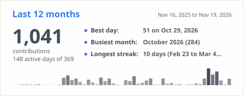

# Hi, I'm Nishal

I build web apps, a browser Android emulator and terminal tools. I also edit AMVs and make music. From Malappuram, Kerala.

[nishal.dev](https://nishal.dev) · [LinkedIn](https://www.linkedin.com/in/nishal-k) · [X](https://x.com/nishal21_) · [dev.to](https://dev.to/nishal21) · [YouTube](https://www.youtube.com/@DemonKing0.___) · [hi@nishal.dev](mailto:hi@nishal.dev)

## What I'm working on

- [FirstPR](https://github.com/nishal21/firstpr): helps open-source beginners make their first PR themselves and get it merged. Finds a good first issue, shows which files it touches, and checks your PR before a maintainer does. Built with Anan Shaji. [Try it](https://firstpr.nishal.dev)
- [NekoDroid](https://github.com/nishal21/NekoDroid): an Android emulator that runs in a browser tab. Written from scratch in Rust, compiled to WebAssembly, no server. Runs bare-metal ARM and a small test APK today, not Play Store apps yet. [Docs](https://docs.nekodroid.tech/)
- [nishal.dev](https://github.com/nishal21/PortfolioV2): my portfolio. It has a voice agent you can call, with two voices (Cartesia and Fish Audio) behind one call bar. [Visit](https://nishal.dev)

## Other things I've made

- [Publicolio](https://github.com/nishal21/Publicolio): turns a GitHub profile into a portfolio page you can theme and share. [App](https://app.publicolio.qzz.io/)
- [World News CLI](https://github.com/nishal21/News-CLI): a full-screen news reader for the terminal, with AI summaries and read-aloud. [PyPI](https://pypi.org/project/worldnews-cli/)
- [UPI Down](https://github.com/nishal21/upi-Down): open it when a UPI payment fails to see which banks and apps people are reporting as down. No login. [App](https://upidown.nishal.dev)

More on [nishal.dev](https://nishal.dev).

## Away from code

I edit AMVs and make remixes in FL Studio. They go up on [YouTube](https://www.youtube.com/@DemonKing0.___).

This profile also has a song made from my contribution graph. Every bar is one week. [Listen](https://nishal21.github.io/nishal21/player/), or [add a note to the visitor song](https://github.com/nishal21/nishal21/issues/new?template=visitor-note.yml).

  <picture>
    <source media="(prefers-color-scheme: dark)" srcset="assets/year-dark.svg">
    <source media="(prefers-color-scheme: light)" srcset="assets/year-light.svg">
    
  </picture>

## Writing

<table>
<thead><tr><th align="left">Post on dev.to</th><th align="left" width="120">Published</th></tr></thead>
<tbody>
<!-- BLOG:START --><tr><td><a href="https://dev.to/nishal21/my-github-profile-sings-now-and-you-can-add-a-line-to-the-song-3cmk">My GitHub profile sings now, and you can add a line to the song</a></td><td>Oct 16, 2026</td></tr><tr><td><a href="https://dev.to/nishal21/i-built-a-full-screen-news-reader-that-lives-in-the-terminal-jmp">I built a full-screen news reader that lives in the terminal</a></td><td>Jul 31, 2026</td></tr><tr><td><a href="https://dev.to/nishal21/i-built-a-zero-config-100-serverless-portfolio-generator-so-you-never-have-to-update-yours-again-14a1">I built a zero-config, 100% serverless portfolio generator so you never have to update yours again.</a></td><td>Apr 13, 2026</td></tr><tr><td><a href="https://dev.to/nishal21/how-i-built-a-memory-safe-steganography-engine-in-rust-to-protect-data-from-ai-scrapers-4cch">How I Built a Memory-Safe Steganography Engine in Rust to Protect Data from AI Scrapers</a></td><td>Mar 28, 2026</td></tr><tr><td><a href="https://dev.to/nishal21/i-built-an-open-source-neo-brutalist-network-diagnostic-tool-react-python-cli-2gbg">I built an open-source, Neo-Brutalist network diagnostic tool (React + Python CLI)</a></td><td>Mar 27, 2026</td></tr><!-- BLOG:END -->
</tbody>
</table>

More on [dev.to/nishal21](https://dev.to/nishal21).

---

## Support

If something I made helped you, you can support my work here:

I'm open to freelance work and collabs, reach me at [hi@nishal.dev](mailto:hi@nishal.dev).
